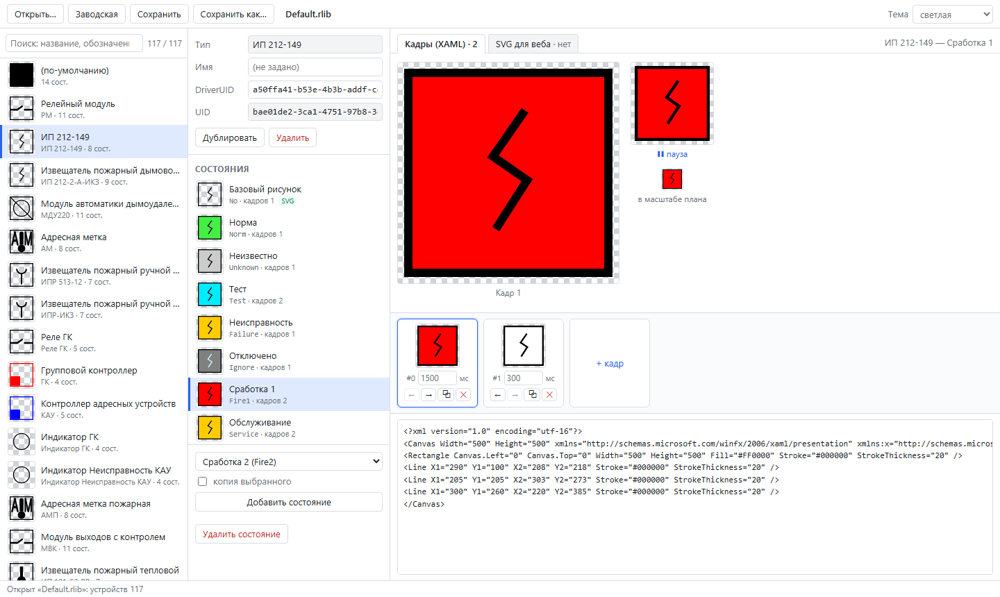
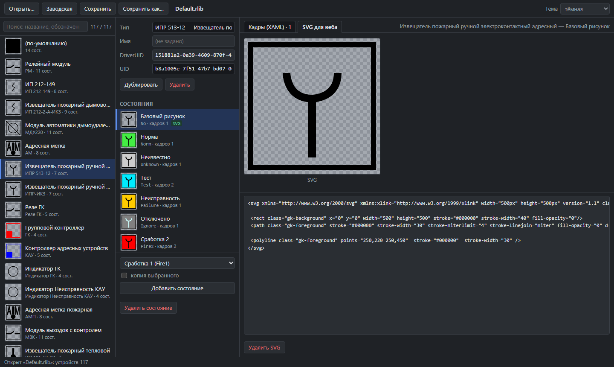
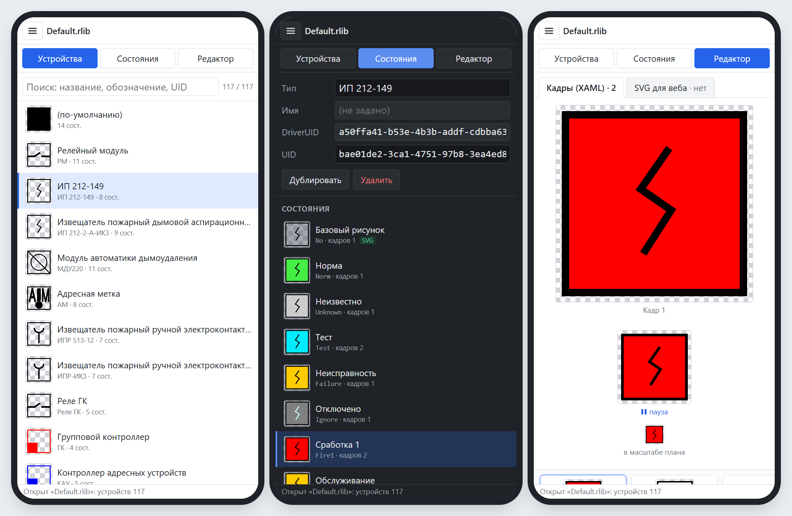

<div align="center">

# PNR.RubezhIconEditor

**Редактор библиотек значков устройств (`*.rlib`) системы «Рубеж»**

Как каждое устройство выглядит на планах в каждом состоянии — норма, пожар, неисправность —
включая покадровую анимацию. Прямо в браузере, без установки и без интернета.

[](https://qui364.github.io/PNR.RubezhIconEditor/)
[](https://github.com/qui364/PNR.RubezhIconEditor/actions/workflows/pages.yml)


</div>

---



<table>
<tr>
<td width="33%" valign="top">

### 🔒 Ничего не уходит в сеть
Файл открывается и сохраняется локально в браузере. Конфигурации объектов никуда не отправляются.

</td>
<td width="33%" valign="top">

### 💾 Без потерь
Открыть → сохранить без правок → тот же файл **байт в байт**. Неизвестные поля, стиль
отступов, BOM и переводы строк сохраняются.

</td>
<td width="33%" valign="top">

### 🧳 Портабельно
Папка `src/` — это и есть приложение. Скопировать на флешку, открыть `index.html` — работает
без установки, прав администратора и интернета.

</td>
</tr>
</table>

## Возможности

- **Устройства** — список с миниатюрами, поиск по названию, обозначению и UID; наименования
  берутся из справочника драйверов, как в администраторе «Рубеж». Дублирование и удаление.
- **Состояния** — все классы (`Норма`, `Сработка 1/2`, `Неисправность`, `Отключено`, …)
  с русскими названиями и цветными превью; добавление, копирование, удаление.
- **Кадры анимации** — превью с проигрыванием по `Duration`, в крупном и реальном масштабе
  плана; добавление, дублирование, перестановка, длительность каждого кадра.
- **XAML-редактор** кадра с живым превью и подсветкой ошибок разбора.
- **SVG для веб-клиента** — редактор и превью, в том числе CSS-оверлеи состояний поверх
  базового рисунка.
- **Заводская библиотека** «Рубеж» 2.8.7 — открывается одной кнопкой, чтобы начать с неё.
- **Сохранение в тот же файл** (Chrome/Edge), в остальных браузерах — скачивание.
- Светлая, тёмная и системная тема; адаптивная вёрстка для телефона.

<details open>
<summary><b>Тёмная тема и SVG для веба</b></summary>



</details>

<details open>
<summary><b>На телефоне</b> — панели по одной: устройства → состояния → редактор</summary>



</details>

## Запуск

| Как | Что сделать |
|---|---|
| 🌐 **Онлайн** | Открыть https://qui364.github.io/PNR.RubezhIconEditor/ |
| 💻 **Без интернета** | Скопировать папку `src/` и открыть `src/index.html` в Chrome или Edge |

Файл `.rlib` можно открыть кнопкой «Открыть…», перетащить в окно или начать с «Заводской».
Горячие клавиши: <kbd>Ctrl</kbd>+<kbd>O</kbd> — открыть, <kbd>Ctrl</kbd>+<kbd>S</kbd> —
сохранить, <kbd>Ctrl</kbd>+<kbd>Shift</kbd>+<kbd>S</kbd> — сохранить как.

> [!TIP]
> Файл из дистрибутива `GKDeviceLibraryConfiguration.xml` — тот же формат, его тоже можно открыть.

> [!IMPORTANT]
> Перед загрузкой правленой библиотеки на объекте сохраните копию исходного файла.

## Формат `.rlib` вкратце

XML, сериализованный .NET `XmlSerializer`: список `GKLibraryDevice` → состояния
`GKLibraryState` → кадры `GKLibraryFrame`. У каждого состояния два независимых рисунка:

| | Для чего | Что внутри |
|---|---|---|
| `Frames/…/Image` | десктоп-клиент | XAML (WPF) `Canvas 500×500`, несколько кадров = анимация |
| `SvgImage` | веб-клиент | полный SVG (обычно в `No`) или CSS поверх SVG базового рисунка |

## Устройство проекта

Vue 3 без сборки, чистый JS и CSS, собственный XML-ридер/райтер (чтобы сохранять файл
без потерь). Никаких npm, CDN и внешних шрифтов — всё лежит в `src/`, та же папка
публикуется на GitHub Pages.

```
src/
  index.html      приложение
  js/xml.js       XML без потерь
  js/rlib.js      модель .rlib
  js/xaml.js      XAML → SVG для превью
  js/svgweb.js    превью SvgImage
  data/           справочник драйверов, заводская библиотека
```

## Отказ от ответственности

> [!WARNING]
> Это неофициальный инструмент. Автор не связан с производителем системы «Рубеж», не
> представляет его и просто мимо проходил. «Рубеж» и другие названия принадлежат их
> правообладателям.
>
> Программа предоставляется **«как есть»**, без каких-либо гарантий. Автор не несёт
> ответственности за последствия её использования: испорченные библиотеки, неверное
> отображение устройств на планах, сбои в работе системы и всё остальное. Проверяйте
> результат в администраторе «Рубеж» и храните резервные копии.

## Лицензия

[MIT](LICENSE)
